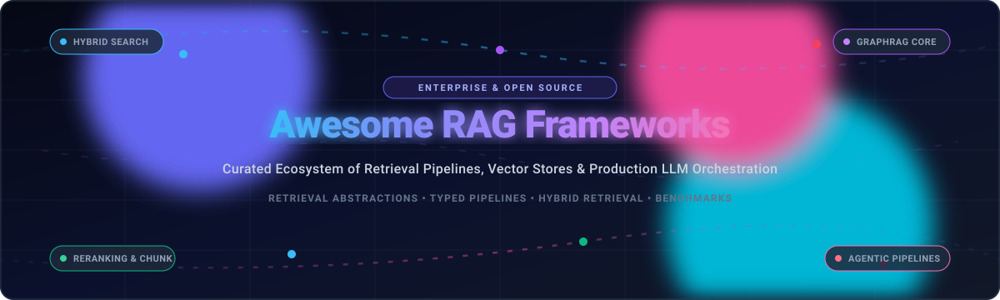

# Awesome-RAG-Frameworks

<div align="center">



# 🚀 Awesome RAG Frameworks 🤖📚

### A Curated Directory of Retrieval-Augmented Generation Pipelines, Vector Engines & Production LLM Orchestration Frameworks

<p align="center">
  <a href="https://github.com/ishandutta2007/Awesome-Awesome-Awesome"></a><a href="https://discord.gg/jc4xtF58Ve"></a>
  <a href="https://github.com/ishandutta2007/Awesome-RAG-Frameworks/stargazers"></a>
  <a href="https://github.com/ishandutta2007/Awesome-RAG-Frameworks/network/members"></a>
  <a href="https://github.com/ishandutta2007/Awesome-RAG-Frameworks/blob/main/LICENSE"></a>
  <a href="https://github.com/ishandutta2007/Awesome-RAG-Frameworks/pulls"></a>
  <a href="https://github.com/ishandutta2007"></a>
</p>

**Keywords:** *Retrieval-Augmented Generation, RAG Frameworks, LLM Orchestration, Vector Search, Semantic Search, Hybrid Retrieval, BM25, Reranking, GraphRAG, Agentic RAG, Knowledge Graphs, Haystack, LlamaIndex, LangChain, RAGFlow, DSPy, Dify*

---

</div>

## 📖 Table of Contents

- [🔍 About RAG Frameworks](#-about-rag-frameworks)
- [📊 Sector Overview & Market Dynamics](#-sector-overview--market-dynamics)
- [🏢 SaaS & Hosted Enterprise RAG Platforms](#-saas--hosted-enterprise-rag-platforms)
- [⚡ Open-Source RAG Frameworks & Engines](#-open-source-rag-frameworks--engines)
- [💡 Architecture Comparison & Selection Guide](#-architecture-comparison--selection-guide)
- [🤝 How to Contribute](#-how-to-contribute)
- [⚖️ Disclaimer & Engineering Guidelines](#-disclaimer--engineering-guidelines)
- [📈 Star History](#-star-history)
- [💖 Support & Sponsorship](#-support--sponsorship)

---

## 🔍 About RAG Frameworks

**Retrieval-Augmented Generation (RAG)** provides the vital orchestration layer connecting private enterprise knowledge bases, unstructured documents, and real-time data stores to Large Language Models (LLMs). 

A production RAG framework automates and streamlines:
- 📥 **Document Ingestion & Parsing:** Chunking, layout-aware OCR, table extraction, and multi-modal pre-processing.
- 🗄️ **Dense & Sparse Indexing:** Generating vector embeddings alongside lexical (BM25) and knowledge-graph indices.
- 🎯 **Hybrid Retrieval & Reranking:** Query transformation, semantic vector matching, cross-encoder reranking, and contextual compression.
- 🧠 **Context Synthesis & Evaluation:** Injecting grounded factual context into prompts, tracking citations, and verifying hallucinations.

---

## 📊 Sector Overview & Market Dynamics

The global Retrieval-Augmented Generation (RAG) and enterprise AI search / LLM orchestration market is estimated at **$1.8 Billion in 2024–2025** and projected to reach **$11.5 Billion by 2030**, expanding at a compound annual growth rate (**CAGR of ~41.2%**). 

The sector exhibits **moderate-to-high fragmentation** rather than a winner-take-all monopoly. Enterprise demand bifurcates across specialized architectural layers:
1. **Low-latency vector databases & indexers** (Pinecone, Weaviate, Qdrant).
2. **Developer-centric typed pipeline DAGs** (Haystack, LlamaIndex, LangChain/LangGraph).
3. **Turnkey visual orchestrators & agentic platforms** (Dify, FastGPT, RAGFlow, Vectara).
4. **Graph-augmented contextual engines** (Microsoft GraphRAG, LightRAG).

Enterprises increasingly reject monolithic lock-in, adopting composable, modular RAG architectures with strict data privacy, multi-tenant RBAC, and hybrid retrieval guarantees.

---

## 🏢 SaaS & Hosted Enterprise RAG Platforms

The following hosted platforms provide managed RAG pipelines, enterprise security compliance (SOC 2, HIPAA), and turn-key vector index infrastructure. Sorted by **Company Size (Valuation / Total Funding) in descending order**:

| Platform | Company Size (Valuation / Funding) | Core Focus & Architecture | Starting Tier Pricing | Free Tier / Trial Limits |
| :--- | :--- | :--- | :--- | :--- |
| **[Pinecone Nexus / Serverless](https://www.pinecone.io/)** | **$750M Valuation** (Raised $138M, Series B) | Managed vector database leader offering serverless indexing, retrieval SDKs, and distilled evidence synthesis. | **$0.33 per GB/month** storage + **$0.0004 per read unit** + **$0.002 per write unit** (Pod plans start at **$0.07/hour** / ~$50.40/month) | **Free Starter plan (free forever):** 1 project, 1 index, up to 2 GB vector storage (~250,000 vectors), and 2,000,000 read units/month. No credit card required. |
| **[Weaviate Cloud (WCD)](https://weaviate.io/)** | **~$200M Valuation** (Raised $67.7M, Series B) | Fully managed AI-native vector database with turn-key Query Agents, hybrid BM25 + dense search, and multimodal connectors. | **$0.085 per 1M vector dimensions/month** stored + **$0.0125 per 1,000 queries** (Production baseline starting at **$25.00/month**) | **14-day free trial Sandbox cluster:** Full vector features, up to 500,000 vector objects, automated expiration, no credit card required. |
| **[Vectara](https://www.vectara.com/)** | **~$150M Valuation** (Raised $53.5M, Series A) | API-first agentic enterprise RAG platform featuring step-level audit trails, hallucination scoring, and end-to-end retrieval governance. | **$99.00/month** (Growth plan includes 500,000 indexed query units and 500 document generations/month) | **Hacker tier (free forever):** Up to 50 document uploads (approx. 5,000 pages or 1M characters), 1,000 queries/month, 1 corpus. |
| **[Qdrant Cloud](https://qdrant.tech/)** | **~$120M Valuation** (Raised $37.8M, Series A) | High-throughput Rust-powered vector engine with rich JSON payload filtering and low-latency hybrid search clustering. | **$25.00/month** for a Managed Dedicated standard cluster (0.5 vCPU, 1 GB RAM, automated snapshots and monitoring) | **Free Forever cluster:** 1 dedicated cloud cluster on AWS/GCP with 1 GB memory (~250,000 768-dim vectors), 0.5 vCPU, no credit card required. |
| **[deepset Cloud](https://www.deepset.ai/)** | **~$100M Valuation** (Raised $46M, Series B) | Commercial managed platform for Haystack pipelines with visual DAG authoring, blue/green pipeline deployments, and observability. | **$280.00/month** (Team tier includes auto-scaling Haystack pipeline runtimes, API endpoints, and monitoring dashboards) | **14-day free trial:** Full visual pipeline builder, 2 active deployment endpoints, and 10,000 pipeline test executions. |
| **[Dify.ai Cloud](https://dify.ai/)** | **~$80M Valuation** (Raised $15M, Series A) | Production LLM app development and visual RAG workflow platform with dataset management, annotation tools, and agent runtimes. | **$59.00/month** (Professional plan includes 5,000 message credits/month, 200 knowledge base documents, 3 team members) | **Sandbox tier (free forever):** 200 OpenAI credit calls, 10 knowledge base datasets (max 50 MB per document upload), 1 team seat. |
| **[FastGPT Cloud](https://fastgpt.in/)** | **~$25M Valuation** (Raised ~$5M, Angel/Series A) | Modular enterprise knowledge-base RAG SaaS offering visual QA workflow chaining, document auto-slicing, and hybrid search. | **¥99.00/month (~$14.00/month)** (Basic plan includes 500,000 input tokens, 200 MB dataset storage, and custom domain access) | **Free plan (free forever):** 100 free query points upon signup, 30 MB knowledge base storage, 2 datasets, community support. |

---

## ⚡ Open-Source RAG Frameworks & Engines

Curated list of production-grade open-source RAG projects, developer libraries, and workflow engines. 

Each repository includes a live social star badge linking to its GitHub Stargazers page, sorted by **Star Count in descending order**:

### 1. [Dify](https://github.com/langgenius/dify) [](https://github.com/langgenius/dify/stargazers)
- 🏷️ **License:** Apache 2.0 | 💻 **Stack:** Python, TypeScript, Next.js
- 📝 **Overview:** An open-source LLM application development platform. Combines an intuitive visual workflow designer, model context management, and a robust RAG pipeline supporting multiple vector databases, hybrid search, document chunking, and multi-agent orchestration.
- 🎯 **Best For:** Teams wanting a self-hosted visual alternative to LangSmith and Flowise with production API deployment.

### 2. [LangChain / LangGraph](https://github.com/langchain-ai/langchain) [](https://github.com/langchain-ai/langchain/stargazers)
- 🏷️ **License:** MIT | 💻 **Stack:** Python, TypeScript
- 📝 **Overview:** The largest ecosystem for building context-aware reasoning applications. Offers hundreds of third-party document loaders, vector store integrations, and memory connectors. **LangGraph** adds cyclic state machines with persistence, human-in-the-loop validation, and multi-agent coordination.
- 🎯 **Best For:** Rapid prototyping, highly customized agent loops, and enterprise integrations requiring extensive ecosystem interoperability.

### 3. [RAGFlow](https://github.com/infiniflow/ragflow) [](https://github.com/infiniflow/ragflow/stargazers)
- 🏷️ **License:** Apache 2.0 | 💻 **Stack:** Python, C++, Docker
- 📝 **Overview:** A next-generation RAG engine based on deep document understanding. Uses vision-based YOLOv8 layout detection (DeepDoc) to parse unstructured PDFs, slides, and scanned tables while preserving exact bounding box coordinates. Features hybrid search, visual pipeline builders, and chunk-level citation groundings.
- 🎯 **Best For:** High-stakes enterprise domains (finance, legal, healthcare) where accurate table parsing and visual citation provenance are mandatory.

### 4. [Mem0](https://github.com/mem0ai/mem0) [](https://github.com/mem0ai/mem0/stargazers)
- 🏷️ **License:** Apache 2.0 | 💻 **Stack:** Python
- 📝 **Overview:** The universal memory layer for personalized AI agents and RAG pipelines. Continuously extracts, scores, updates, and deduplicates user preferences, entity relations, and historical interactions across sessions to augment contextual generation.
- 🎯 **Best For:** Stateful RAG applications requiring personalized, long-term memory across chat conversations.

### 5. [Pathway](https://github.com/pathwaycom/pathway) [](https://github.com/pathwaycom/pathway/stargazers)
- 🏷️ **License:** Apache 2.0 | 💻 **Stack:** Python, Rust
- 📝 **Overview:** High-throughput streaming ETL and real-time computation engine designed for "Always-Live" RAG. Keeps vector indices and document collections synchronized instantaneously with streaming event buses (Kafka), cloud drives (SharePoint, Google Drive), and databases without expensive bulk re-indexing.
- 🎯 **Best For:** Real-time data streams, live financial analytics, and dynamic enterprise intranets where documents update continuously.

### 6. [LlamaIndex](https://github.com/run-llama/llama_index) [](https://github.com/run-llama/llama_index/stargazers)
- 🏷️ **License:** MIT | 💻 **Stack:** Python, TypeScript
- 📝 **Overview:** Purpose-built data framework for ingesting, structuring, and accessing private or domain-specific enterprise data for LLMs. Includes 160+ data connectors, advanced chunking (hierarchical, sentence-window), query engines, and native async evaluation suites (faithfulness, relevancy).
- 🎯 **Best For:** Data-first teams building high-accuracy document search, hierarchical indices, and multi-document synthesis.

### 7. [LightRAG](https://github.com/HKUDS/LightRAG) [](https://github.com/HKUDS/LightRAG/stargazers)
- 🏷️ **License:** MIT | 💻 **Stack:** Python
- 📝 **Overview:** Simple, ultra-fast GraphRAG implementation from HKUDS. Incorporates dual-level retrieval (low-level specific entity search and high-level abstract topic search) combined with incremental graph updates and multi-backend persistence (NetworkX, Neo4j, NanoVectorDB).
- 🎯 **Best For:** Complex multi-hop reasoning over large knowledge corpuses without the indexing overhead of traditional heavy graph engines.

### 8. [DSPy](https://github.com/stanfordnlp/dspy) [](https://github.com/stanfordnlp/dspy/stargazers)
- 🏷️ **License:** MIT | 💻 **Stack:** Python
- 📝 **Overview:** Stanford's programmatic framework for compiling, optimizing, and evaluating language model pipelines. Replaces brittle, handcrafted prompt strings with modular, typed Python signatures. DSPy teleprompters automatically synthesize optimal prompt instructions and few-shot exemplars against measurable validation metrics.
- 🎯 **Best For:** Algorithmic prompt optimization, reproducible retrieval pipelines, and systematic performance tuning.

### 9. [Langchain-Chatchat](https://github.com/chatchat-space/Langchain-Chatchat) [](https://github.com/chatchat-space/Langchain-Chatchat/stargazers)
- 🏷️ **License:** Apache 2.0 | 💻 **Stack:** Python
- 📝 **Overview:** Formerly Langchain-ChatGLM; a widely adopted open-source local knowledge base solution supporting offline LLM deployment, multi-vector embeddings, and localized document Q&A across Chinese and multilingual corpuses.
- 🎯 **Best For:** Turnkey local intranet deployment with complete offline security and consumer GPU support.

### 10. [Microsoft GraphRAG](https://github.com/microsoft/graphrag) [](https://github.com/microsoft/graphrag/stargazers)
- 🏷️ **License:** MIT | 💻 **Stack:** Python
- 📝 **Overview:** Modular Graph-based Retrieval-Augmented Generation pipeline developed by Microsoft Research. Extracts semantic knowledge graphs from raw text, clusters them hierarchically using Leiden community detection, and generates multi-level summaries for comprehensive holistic dataset question-answering.
- 🎯 **Best For:** Global corpus-level queries ("What are the main systemic themes across all 5,000 incident reports?") where baseline vector search fails.

### 11. [FastGPT](https://github.com/labring/FastGPT) [](https://github.com/labring/FastGPT/stargazers)
- 🏷️ **License:** Apache 2.0 | 💻 **Stack:** TypeScript, Next.js, Go
- 📝 **Overview:** Enterprise-grade knowledge base Q&A platform with visual drag-and-drop workflow authoring. Provides automated data ingestion, QA split generation, vector retrieval, reranking, and full multi-tenant team collaboration.
- 🎯 **Best For:** Customer service bots, corporate internal wikis, and enterprise knowledge portal deployments.

### 12. [Haystack](https://github.com/deepset-ai/haystack) [](https://github.com/deepset-ai/haystack/stargazers)
- 🏷️ **License:** Apache 2.0 | 💻 **Stack:** Python
- 📝 **Overview:** The strictly typed, explicit-component orchestration framework for production RAG by deepset. Pipelines are deterministic directed acyclic graphs (DAGs) with static type validation, serializable to YAML, and deployable via Hayhooks as self-hosted REST/MCP servers.
- 🎯 **Best For:** Auditable enterprise pipelines requiring deterministic execution, strict type safety, and Kubernetes-native deployment.

### 13. [Kotaemon](https://github.com/Cinnamon/kotaemon) [](https://github.com/Cinnamon/kotaemon/stargazers)
- 🏷️ **License:** Apache 2.0 | 💻 **Stack:** Python, Gradio
- 📝 **Overview:** Clean local-first RAG UI focused on visual citations and parent-child chunk retrieval. Clicking any generated citation opens the source document viewer with precise highlighted bounding boxes. Supports local Ollama backends and GraphRAG pipelines.
- 🎯 **Best For:** Researchers, students, and engineers needing verifiable citations in PDF document analysis on local workstations.

### 14. [QAnything](https://github.com/netease-youdao/QAnything) [](https://github.com/netease-youdao/QAnything/stargazers)
- 🏷️ **License:** Apache 2.0 | 💻 **Stack:** Python, C++
- 📝 **Overview:** NetEase Youdao's enterprise local knowledge base engine designed to parse any document format (PDF, DOCX, PPTX, XLS, audio, video). Features a dedicated two-stage reranking pipeline for extreme retrieval accuracy.
- 🎯 **Best For:** Heterogeneous enterprise files, cross-format document search, and multilingual knowledge retrieval.

### 15. [R2R](https://github.com/SciPhi-AI/R2R) [](https://github.com/SciPhi-AI/R2R/stargazers)
- 🏷️ **License:** MIT | 💻 **Stack:** Python, TypeScript
- 📝 **Overview:** Production-ready SOTA AI retrieval system. Ships as a containerized REST API with multimodal ingestion, hybrid search, automatic knowledge-graph extraction, multi-tenant RBAC, and client SDKs.
- 🎯 **Best For:** Developers who want an out-of-the-box backend service instead of coding retrieval pipelines from scratch.

### 16. [Verba](https://github.com/weaviate/Verba) [](https://github.com/weaviate/Verba/stargazers)
- 🏷️ **License:** BSD-3-Clause | 💻 **Stack:** Python, React
- 📝 **Overview:** The "Golden RAGtriever" open-source application by Weaviate. Offers a modern web UI pre-configured with optimal chunking strategies, embedding models, vector caches, and generative answer synthesis.
- 🎯 **Best For:** Quickly deploying a clean, responsive RAG web application connected directly to Weaviate.

### 17. [UltraRAG](https://github.com/OpenBMB/UltraRAG) [](https://github.com/OpenBMB/UltraRAG/stargazers)
- 🏷️ **License:** Apache 2.0 | 💻 **Stack:** Python
- 📝 **Overview:** A low-code, MCP-based framework from OpenBMB for composing complex, innovative RAG pipelines and collaborative agent workflows with standardized tool protocols.
- 🎯 **Best For:** Standardizing tool execution, MCP integrations, and composable multi-agent research pipelines.

### 18. [AutoRAG](https://github.com/Marker-Inc-Korea/AutoRAG) [](https://github.com/Marker-Inc-Korea/AutoRAG/stargazers)
- 🏷️ **License:** Apache 2.0 | 💻 **Stack:** Python
- 📝 **Overview:** Automated optimization and evaluation framework for RAG. Automatically benchmarks and searches through combinations of chunk sizes, embedding models, retrieval strategies, and rerankers against your evaluation dataset.
- 🎯 **Best For:** Finding the mathematically optimal RAG pipeline configuration without manual trial-and-error.

### 19. [Cognita](https://github.com/truefoundry/cognita) [](https://github.com/truefoundry/cognita/stargazers)
- 🏷️ **License:** Apache 2.0 | 💻 **Stack:** Python
- 📝 **Overview:** Open-source RAG framework by TrueFoundry that decouples Indexers, Retrievers, and Parsers into modular, independently scalable microservices with built-in FastAPI endpoints.
- 🎯 **Best For:** Production microservice architectures, enterprise A/B testing of retrieval components, and Kubernetes scaling.

### 20. [FlashRAG](https://github.com/RUC-NLPIR/FlashRAG) [](https://github.com/RUC-NLPIR/FlashRAG/stargazers)
- 🏷️ **License:** MIT | 💻 **Stack:** Python
- 📝 **Overview:** A lightweight Python research toolkit for efficient RAG benchmarking. Implements 32 state-of-the-art RAG algorithms and 36 benchmark datasets with optimized acceleration scripts.
- 🎯 **Best For:** Academic research, systematic algorithmic benchmarking, and reproduction of state-of-the-art RAG papers.

### 21. [HuixiangDou](https://github.com/InternLM/HuixiangDou) [](https://github.com/InternLM/HuixiangDou/stargazers)
- 🏷️ **License:** Apache 2.0 | 💻 **Stack:** Python
- 📝 **Overview:** Domain-specific knowledge assistant and group chat RAG bot by InternLM. Employs a pre-retrieval intent filter to reject irrelevant queries and avoid spamming group channels, followed by precise semantic retrieval.
- 🎯 **Best For:** Group chat assistance (WeChat, Lark, DingTalk, Discord) with aggressive false-positive query filtering.

---

## 💡 Architecture Comparison & Selection Guide

Selecting the appropriate RAG framework depends on structural trade-offs between pipeline determinism, deployment infrastructure, and document complexity:

```
                      ┌────────────────────────────────────────┐
                      │    What is your core engineering goal? │
                      └──────────────────┬─────────────────────┘
                                         │
         ┌───────────────────────────────┼───────────────────────────────┐
         ▼                               ▼                               ▼
┌──────────────────┐           ┌──────────────────┐           ┌──────────────────┐
│ Visual Workflows │           │  Typed Pipeline  │           │ Graph & Semantic │
│ & Low-Code Apps  │           │   Engineering    │           │    Reasoning     │
└────────┬─────────┘           └────────┬─────────┘           └────────┬─────────┘
         │                              │                              │
    • Dify                         • Haystack                     • Microsoft GraphRAG
    • FastGPT                      • LlamaIndex                   • LightRAG
    • RAGFlow                      • LangChain/LangGraph          • DSPy
    • Kotaemon                     • Cognita                      • Pathway (Streaming)
```

### Key Architectural Dimensions:

1. **Pipeline Determinism vs Agentic Flexibility:**
   - **Deterministic DAGs (Haystack, Cognita):** The retrieval path is strictly wired at compile time. Offers reproducible latency, auditable logs, and predictable token costs.
   - **Agentic Dynamic Loops (LangGraph, Dify):** The LLM autonomously chooses retrieval tools, rewrites queries, and branches. Trades predictability for flexible multi-step question resolution.

2. **Document Parsing Fidelity:**
   - **Text-Only Chunkers (Standard LangChain/LlamaIndex):** Fast and lightweight, but corrupts multi-column reports, complex formulas, and financial tables.
   - **Layout-Aware DeepDoc OCR (RAGFlow, QAnything):** Accurately preserves tabular row/column geometries and spatial bounding boxes at the cost of requiring GPU parsing workers.

3. **Data Freshness & Stream Processing:**
   - **Batch Vector Indices (Standard Vector DBs):** Periodic re-indexing scripts.
   - **Continuous Stream Sync (Pathway):** Vector indices update instantaneously as documents update on Kafka or cloud drives with zero downtime.

---

## 🤝 How to Contribute

We welcome additions, corrections, and benchmark additions from the AI community!

1. Fork this repository: `https://github.com/ishandutta2007/Awesome-RAG-Frameworks`
2. Create your feature branch: `git checkout -b feature/add-new-framework`
3. Add your entry to the appropriate section following the existing format.
4. Ensure all links are functional and descriptions are factual and objective.
5. Submit a descriptive Pull Request!

---

## ⚖️ Disclaimer & Engineering Guidelines

- This is a community-curated directory intended for educational and architectural evaluation purposes.
- Always benchmark retrieval latency, precision@K, NDCG, and mean reciprocal rank (MRR) against your own domain-specific documents before selecting an architecture.
- For all awesome list references, explore [Awesome-Awesome-Awesome](https://github.com/ishandutta2007/Awesome-Awesome-Awesome).

---

## 📈 Star History

[](https://star-history.dera.page/#ishandutta2007/Awesome-RAG-Frameworks&type=date&legend=top-left)

---

## 💖 Support & Sponsorship

Thank you for visiting **Awesome-RAG-Frameworks**! If this curated guide saves you architectural research time or helps power your production AI stack, please consider supporting the project:

- ⭐ **Star this repository** to stay informed on the rapidly evolving RAG ecosystem.
- 🍴 **Fork and contribute** your tools, benchmarks, and production insights.
- 📢 **Share** with colleagues and AI engineering communities.
- ☕ **Support development:** Buy a coffee or sponsor ongoing maintenance directly via the [GitHub Sponsor Dashboard](https://github.com/sponsors/ishandutta2007).

---

<div align="center">
  <sub>Maintained with ❤️ by <a href="https://github.com/ishandutta2007">Ishan Dutta</a> and the open-source AI community.</sub>
</div>
